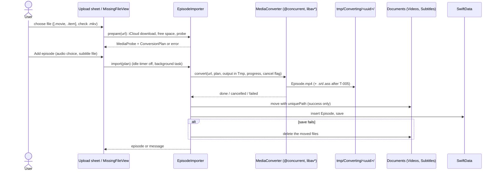

# MKV episodes: convert on import

* Author: bman7222 (drafted by loop-planner)
* Status: Accepted (Brent, 2026-11-19: option A with all defaults in "Decisions"; built-in subtitle extraction made optional, delivered last). Revised 2026-11-19 after /architecture-review (see `mkv-import.review.md`); the app-licence question below must be answered before the repo goes public.
* Date: 2026-11-19

## Problem

Most anime and drama episodes come as `.mkv` (Matroska) files, often with the subtitles inside the file. Clip Deck only accepts MP4/MOV/M4V today (`FileStore.videoExtensions`, `FileTypes.videos`). Playback (`AVPlayer`), audio clip cutting (`AVAssetExportSession`) and screenshots (`AVAssetImageGenerator`) are all AVFoundation, and AVFoundation cannot open Matroska. So Brent has to convert every episode on a PC before he can mine it on the phone.

## Goals

* Picking an `.mkv` in Upload episode gives an episode that plays, seeks, shows subtitles and makes cards exactly like an MP4 episode, with the picture, audio and subtitle times lined up as in the source.
* An MKV with no subtitle tracks (or only picture ones) imports with no error or warning; the user adds a subtitle file the normal way.
* Converting never freezes the UI, never leaves half-written files in the library, and survives the screen auto-locking.
* Optional, delivered last (T-005): text subtitle tracks inside the MKV (SRT, ASS/SSA) become ordinary subtitle files in `Subtitles/<Show>/<Episode>/`.
* When an MKV can't be used (unsupported video, damaged file, not enough space), the user is told which part and what to do.
* The FFmpeg licence (LGPL-2.1) is honoured inside the app and in public releases.

## Non-goals

* Playing MKV directly without conversion (no second player stack).
* Re-encoding video on the phone. Unsupported video (H.264 10-bit "Hi10P", 4:2:2/4:4:4, 12-bit, VP9, MPEG-4 ASP, Dolby Vision profile 5, AV1 on devices without AV1 hardware) is rejected with advice.
* OCR of picture subtitles (PGS, VobSub, DVB).
* Other containers (AVI, WebM, TS).
* Keeping several audio tracks in one episode, or switching dub/original audio after import.
* Converting in the background for minutes after the user leaves the app (`BGContinuedProcessingTask` on iOS 26+ is a possible follow-up, untested on a free sideload).

## User journeys

### J-1: Add an MKV episode (the built-in subtitle parts arrive with optional T-005)
* Given: Brent has `Frieren 03.mkv` (HEVC Main10 video, Japanese AAC + English FLAC audio, ASS "Full" and ASS "Signs" tracks) in the Files app.
* When: he opens Upload episode, chooses the file, keeps the default audio (the file's default track), adds his own `.srt` (or, after T-005, picks "ASS · jpn · Full" under Embedded subtitles), and taps Add episode.
* Then: the sheet shows "Converting… n%" with Cancel, and the screen stays awake. When it's done, the episode opens with the Japanese audio and the chosen subtitles, in sync. `Videos/Frieren/Episode 3.mp4` exists and no copy of the `.mkv` is kept.

### J-2: Switch to another embedded subtitle track later (optional, T-005)
* Given: J-1 with T-005 delivered.
* When: Brent opens the player's subtitles menu › Load different subtitles.
* Then: the other extracted track ("Signs") is listed with the existing files.

### J-3: MKV with an external subtitle file (main path, T-006)
* Given: an MKV with no text subtitle tracks, and an `.srt` in Files.
* When: he picks both and taps Add episode.
* Then: the `.srt` is assigned as today, with no error, warning or Embedded subtitles row.

### J-4: Unsupported video
* Given: an MKV whose video is H.264 10-bit, VP9, 4:2:2 or Dolby Vision profile 5.
* When: he chooses it.
* Then: an inline error names the format and suggests converting on a computer to H.264 8-bit or HEVC (for example with HandBrake). Add episode stays disabled and nothing is written.

### J-5: Cancel, failure, crash or backgrounding while converting
* When: he taps Cancel, the conversion fails, the app goes to the background for longer than iOS allows, or the app is killed.
* Then: no episode is created and nothing is left in `Videos/` or `Subtitles/`. The sheet stays open with a message (for backgrounding: "Conversion stopped. Keep Clip Deck open until it finishes."). After a crash or kill, leftovers in the temporary folder are removed at the next launch.

### J-6: Missing video re-linked with an MKV
* Given: an episode whose video file is missing.
* When: he taps Choose the video again and picks an MKV.
* Then: the same progress and Cancel UI appears; it converts with the default audio track and the episode plays. `videoPath` points at the new `.mp4`.

### J-7: File still in iCloud, or not enough space
* Given: the MKV is in iCloud Drive and not downloaded yet, or the phone has less free space than the file needs.
* When: he chooses it.
* Then: an iCloud file shows "Downloading from iCloud…" until it is local, and is then probed. With too little space he sees "This needs about 1.6 GB free; you have 0.9 GB." and Add episode stays disabled.

## Technical design

### FFmpeg package (T-012)
* Use `superuser404notfound/FFmpegBuild` **3.16.0** (FFmpeg n8.1.3, LGPL-2.1, built without `--enable-gpl` or `--enable-version3`, dynamic xcframeworks with `ios-arm64` and simulator slices, iOS 16+). Add it in `ios/project.yml` `packages:` with `exactVersion: 3.16.0`. Link only the individual products `AetherLibavformat`, `AetherLibavcodec`, `AetherLibavutil` and `AetherLibswresample`.
* Not usable: `kingslay/FFmpegKit` (GPL; LGPL is paid), ffmpeg-kit forks (unmaintained GPL re-hosts), MPVKit (LGPL-3.0, no FFmpeg-only product), `kewlbear/FFmpeg-iOS` (last release 2023), `arthenica/ffmpeg-kit` (retired).
* Required components, checked against the package's `BUILD-INFO.txt`: matroska demuxer; mov/mp4 muxer; decoders for AC-3, E-AC-3, FLAC, Opus, Vorbis, DTS, TrueHD and PCM; an AAC encoder (`aac_at` preferred, else `aac`); swresample; the h264, hevc and av1 parsers (stream copy needs no video decoder). If a required component is missing, stop and report it.
* Known limits: the package has no matroska, srt or ass muxer, so test MKVs come from Homebrew FFmpeg in CI, and T-005 writes `.srt`/`.ass` in Swift. It has one maintainer and locally built binaries.
* Supply-chain plan: record the binary target URLs and SPM checksums in ARCHITECTURE.md. If the xcframeworks live in the package's git repo, the orchestrator forks it at the tag (with Brent's OK) and `project.yml` points to the fork. If they are URL release assets, the checksum already locks the bytes; a fork alone would not copy them, so re-hosting them is a follow-up. Fallback if the package disappears or breaks: build our own LGPL FFmpeg in CI (separate decision).

### Concurrency (T-004)
* The app target has `SWIFT_DEFAULT_ACTOR_ISOLATION: MainActor` and `SWIFT_APPROACHABLE_CONCURRENCY: YES`, so `nonisolated async` functions run on the caller's actor and would freeze the UI. The convert entry point is `@concurrent` (or wraps a synchronous core in `Task.detached`, as `FileStore.importFile` does).
* All libav pointers live inside one synchronous function. Only Sendable values (URLs, probe structs, plan, progress doubles) cross.
* Cancellation: `withTaskCancellationHandler` sets an `OSAllocatedUnfairLock<Bool>` flag, which an `AVIOInterruptCB` and the packet loop both read. (`Synchronization.Atomic`/`Mutex` need iOS 18; the app targets 17.) It stops within about 1 s.
* Progress: a `@Sendable (Double) -> Void` callback, throttled to about 10 per second. The UI hops to the main actor.

### Conversion rules (T-004; subtitles T-005)
* **Timeline rule:** MP4 time t = MKV time t. There is no rebasing. Stream start offsets and audio delays become MP4 edit lists. Extracted subtitles use the same clock. Use FFmpeg's `remux.c` pattern (`av_packet_rescale_ts`, valid increasing DTS, `av_interleaved_write_frame`). No `+faststart` (it rewrites the whole file and doubles the I/O).
* **Video allow-list** (stream copy only):
  * H.264 with `yuv420p`;
  * HEVC Main/Main10 with `yuv420p`/`yuv420p10le`, tagged `hvc1`;
  * Dolby Vision profile 8.x as `hvc1` (base layer);
  * AV1 (`yuv420p`/`yuv420p10le`) only when the plan's `supportsAV1` input is true. The caller passes `VTIsHardwareDecodeSupported(kCMVideoCodecType_AV1)`.
  * Rejected, each with a message naming it: Dolby Vision profile 5, 4:2:2, 4:4:4, 12-bit, H.264 10-bit, and every other codec.
* **Audio:** exactly one track, the user's choice (default: the file's default-flagged track, else the first).
  * AAC and MP3 with at most 2 channels are copied.
  * Everything else is transcoded to AAC-LC stereo at 192 kbit/s, resampled to the source rate but at most 48 kHz. That covers AAC/MP3 with more than 2 channels, AC-3, E-AC-3, FLAC, Opus, Vorbis, DTS, TrueHD and PCM.
  * **AAC 5.1 becomes stereo** (decided by Brent, 2026-11-19).
* **Subtitles:** T-004/T-006 ignore subtitle streams silently and never write them into the MP4. T-005 writes text tracks as files: SubRip and WebVTT become `.srt`; ASS/SSA become `.ass`, built from the track's CodecPrivate header plus `Dialogue:` lines rebuilt from packets and timestamps. File names are `<n> <language> <title>.<ext>`. Picture tracks are skipped.
* The MKV is read in place through its security-scoped URL; it is never copied into the app.

### Import, files and lifecycle (T-006)
* **Staging:** the converter writes only into `tmp/Converting/<uuid>/`. On success, `EpisodeImporter` moves the results into `Documents/Videos/<Show>/` (and `Subtitles/...`) with `FileStore.uniquePath`, then inserts the Episode and saves. If the save fails, it deletes the moved files. This also fixes today's MP4 path, where a failed `context.save()` leaves orphaned files. `tmp/Converting/` is swept at every launch.
* **Screen lock and background:** while converting, `UIApplication.shared.isIdleTimerDisabled = true` (restored afterwards), plus a `beginBackgroundTask`. When that background time expires, the conversion is cancelled (J-5).
* **Free space:** `volumeAvailableCapacityForImportantUsageKey` must be at least the source size plus a margin (the larger of 10 % and 200 MB).
* **iCloud files:** check `ubiquitousItemDownloadingStatus`. If the file isn't current, call `startDownloadingUbiquitousItem`, show "Downloading from iCloud…", and read through `NSFileCoordinator` (coordinated read) for the probe and the conversion.
* **Picker:** `[.movie, .item]` from the start, for both upload and relink. After picking, check the extension (`mp4`, `mov`, `m4v`, `mkv`), as subtitles already do.
* **Relink:** `MissingFileView` goes through the same `EpisodeImporter`, with the same progress and Cancel UI.

### Contracts
* `MediaProbe` (T-004): container; duration; start time; video (codec, profile, pixel format, bit depth, size, Dolby Vision profile if any); audio tracks (stream index, codec, language, title, channels, sample rate, start offset, isDefault); subtitle tracks (stream index, codec, language, title, isDefault, isText).
* `ConversionPlan` (T-004): a pure function of (`MediaProbe`, chosen audio index, `supportsAV1`, and, after T-005, chosen subtitle tracks). It returns a plan or a typed unsupported error with a user message.
* `MediaConverter.convert` (T-004): `@concurrent`; writes only to the output URL(s) it is given; deletes them on cancel or failure.
* `EpisodeImporter` (T-006): prepare (iCloud, space, probe, plan) and import (stage, convert or copy, move, save, rollback). It takes an options value that T-005 extends with subtitle extraction. SwiftData models don't change.

### Tests (fixtures from T-012)
* In CI the simulator job runs `brew install ffmpeg` (a build-time tool only, never shipped). Then `scripts/make-test-media.sh` (called by `scripts/test-ios.sh`) generates the fixture MKVs into `build/fixtures/` (git-ignored). Their video is a solid colour per second and their audio has beeps at known times, so sync can be measured. The fixtures:
  1. H.264 with B-frames, AAC stereo, an SRT track and an ASS track (Japanese);
  2. HEVC Main10 with open GOP, FLAC audio;
  3. a 1.0 s start offset with the audio delayed 0.5 s, AC-3 5.1 audio, an SRT track;
  4. no subtitles, AAC 5.1;
  5. H.264 Hi10P (must be rejected).
* The folder reaches the tests through `TEST_RUNNER_CLIPDECK_FIXTURES`. UI tests forward it to the app through `launchEnvironment`; manual simulator launches use `SIMCTL_CHILD_CLIPDECK_FIXTURES`. The `-uiTestingMKV` seed uses the same fixtures. No binaries in git.

### LGPL compliance (T-012)
Public GitHub Releases (T-009/T-010) are distribution. So:
* the app bundles the LGPL-2.1 text and an FFmpeg notice, shown under Settings › About and licences;
* the app and the release notes link to the exact FFmpegBuild source tag and the FFmpeg n8.1.3 source;
* the app's own licence (root `LICENSE`, also bundled and shown in the app, T-012): "Copyright (c) 2026 Brent. All rights reserved." plus the one permission LGPL-2.1 §6 requires (modify the app and reverse engineer it to debug modifications to the bundled FFmpeg libraries). Decided by Brent 2026-11-19; marked as not legal advice;
* CI unzips the IPA and checks the notices are inside.

### Docs to change
* ARCHITECTURE.md: diagram, "Video formats" row, package and checksums, concurrency rule.
* PRODUCT_SPEC.md and README: formats.
* DEVELOPMENT.md: the `ffmpeg` requirement for tests, fixtures, troubleshooting.
* New `THIRD_PARTY_NOTICES.md`.

## Decisions

| Decision | Chosen | Instead of | Why | Cost |
|---|---|---|---|---|
| How to support MKV | Convert to MP4 on import with an LGPL FFmpeg build | VLCKit or libmpv playback | Player, exact seeking, M4A clip export, screenshots, offset and all tests stay on AVFoundation | Import takes time; some codecs rejected; the app grows |
| Package | `superuser404notfound/FFmpegBuild` 3.16.0, exactVersion, per-library products | kingslay/FFmpegKit, ffmpeg-kit forks, MPVKit, FFmpeg-iOS | The only candidate that is LGPL-2.1, dynamic, maintained and has simulator slices (architecture review) | One maintainer; no matroska/srt/ass muxers; supply-chain risk handled by pinning and checksums, with own-build fallback |
| Licence handling | Notices and LGPL text inside the app; source links in the app and release notes; app `LICENSE` = all rights reserved + LGPL-2.1 §6 clause (Brent) | Repo-only notice; MIT | Public releases are distribution; Brent wants the code to stay his | Small About screen; the clause must stay in the licence while FFmpeg ships |
| Unsupported video | Reject with advice | Re-encode on the phone | Slow, battery-heavy, a second encoder path | Hi10P/VP9/4:2:2 files still need a computer |
| Audio tracks | Keep one, chosen at import (default = file default) | Keep all plus a switcher | Keeps `ClipExtractor` correct and the UI simple | Changing dub/original means re-importing |
| Multichannel audio | AAC/MP3 above 2 channels are transcoded to stereo AAC (decided by Brent) | Copy 5.1 as is | Card clips are dialogue, played on phones; one predictable clip-export path; the iPhone speaker is stereo anyway | Some seconds of extra encode time; surround is lost |
| Timeline | No rebase; edit lists carry offsets | Shift everything to start at 0 | Subtitle files made for the MKV stay in sync without an offset | Edit lists must be tested (fixture 3) |
| Where conversion writes | `tmp/Converting/<uuid>/`, moved on success | Write straight into Documents | A crash or kill can't leave half files in the library | One move per import (same volume, instant) |
| Embedded subtitles | Optional add-on, delivered last (T-005) | Required | Brent usually uploads subtitle files ("helpful… not a requirement") | Extra files per episode once T-005 lands |
| Keep the MKV | No | Store both | Halves storage | Re-import needs the original |

## Risks and rollout

* **Package:** pinned with exactVersion and checksums; T-012 proves it links and opens every fixture in CI before the converter is built. If it vanishes, fall back to our own LGPL build in CI.
* **Device-only behaviour:** Files picker, iCloud download, auto-lock, real-world MKVs, HEVC 10-bit and Dolby Vision playback can only be checked by Brent (Unverified items for the tester).
* **Licence:** the repo must not go public until T-012's `LICENSE` and in-app notices have landed.
* **Compatibility:** existing MP4 episodes and SwiftData stores are untouched; no migration.
* **Rollback:** revert the commits; MP4 import never depended on the package.

## Acceptance

| ID | Done when | Proves | How to check |
|---|---|---|---|
| AC-1 | The package builds for Debug, tests and the unsigned Release IPA; `BUILD-INFO.txt` has every required component; each fixture opens with libavformat in a unit test | Goals | CI (T-012) |
| AC-2 | Fixtures 1 to 4 convert to MP4s that AVFoundation reports playable, with 1 video + 1 audio track and duration ±150 ms | J-1 | Unit tests (T-004) |
| AC-3 | `ClipExtractor` cuts a 2 s clip (±150 ms) and a screenshot from each converted file | J-1 | Unit tests (T-004) |
| AC-4 | (Optional, T-005) SRT and ASS tracks are written, parse with `SubtitleParser`, keep Japanese text, and their cue times match the source within 40 ms, including fixture 3 | J-1, J-2 | Unit tests (T-005) |
| AC-5 | `ConversionPlan` follows the allow-list and audio rules, including Hi10P (fixture 5), DV 5, 4:2:2, 12-bit and AV1 with and without `supportsAV1` | J-4 | Unit tests on probe values + fixture 5 (T-004) |
| AC-6 | Cancel and failure leave no files and no episode; leftovers in `tmp/Converting` are swept at launch; nothing ever appears in `Videos/` before success; a failed SwiftData save removes the moved files | J-5 | Unit tests (T-004, T-006) |
| AC-7 | Upload sheet: MKV accepted, audio picker, normal subtitle-file import, progress, Cancel; episode plays (T-006) | J-1, J-3 | UI test with `-uiTestingMKV` + screenshots |
| AC-8 | Choose the video again accepts an MKV through the same importer and UI | J-6 | Importer unit test; device check by Brent |
| AC-9 | An MKV with no subtitle tracks, or only picture ones, converts and imports with no error or warning | J-3 | Fixture 4 + plan tests (T-004, T-006) |
| AC-10 | Sync: in fixtures 1 and 3, the screenshot at time t shows the source frame for t (within one frame) and the audio beeps land within 40 ms | J-1 | Unit tests (T-004) |
| AC-11 | Conversion runs off the main thread; a main-actor heartbeat keeps ticking during it; cancel stops within about 1 s | Goals | Unit tests (T-004) |
| AC-12 | The IPA contains the LGPL text and notices; Settings › About and licences shows them with source links | Licence | CI unzip check + UI test (T-012) |
| AC-13 | iCloud-only files download before probing; too little space is refused with sizes; the screen doesn't auto-lock while converting | J-7, J-5 | Unit tests for the space rule; device check by Brent (T-006) |

## Open decisions

* Approach: **decided** (Brent, 2026-11-19): convert on import with LGPL FFmpeg.
* Defaults: **accepted**: one audio track chosen at import (default = the file's default track); refuse video the iPhone can't play; don't keep the original MKV. Built-in subtitles are **optional and delivered last**.
* Package: **decided by the architecture review**: FFmpegBuild 3.16.0 (see above).
* AAC 5.1: **decided by Brent** (2026-11-19): transcode to stereo.
* App licence: **decided by Brent** (2026-11-19): all rights reserved + the LGPL-2.1 §6 clause, as a root `LICENSE` added and shown in the app by T-012. T-010's repo-public step waits for it.
