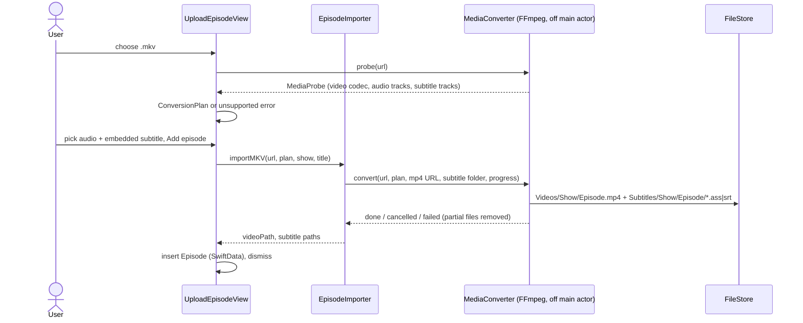

# MKV episodes: convert on import

* Author: bman7222 (drafted by loop-planner)
* Status: Accepted (Brent, 2026-11-19: option A with all defaults in "Decisions"; built-in subtitle extraction made optional, delivered last)
* Date: 2026-11-19

## Problem

Most anime and drama episodes come as `.mkv` (Matroska) files, often with the subtitles inside the file. Clip Deck only accepts MP4/MOV/M4V today (`FileStore.videoExtensions`, `FileTypes.videos`), because playback (`AVPlayer`), audio clip cutting (`AVAssetExportSession`) and screenshots (`AVAssetImageGenerator`) are all AVFoundation, and AVFoundation cannot open Matroska. Brent has to convert every episode on a PC before he can mine it on the phone.

## Goals

* Picking an `.mkv` in Upload episode gives an episode that plays, seeks, shows subtitles and makes cards exactly like an MP4 episode.
* An MKV with no subtitle tracks (or only picture ones) imports with no error or warning; the user adds a subtitle file the normal way.
* Optional, delivered last (T-005): text subtitle tracks inside the MKV (SRT, ASS/SSA) become ordinary subtitle files in `Subtitles/<Show>/<Episode>/`, so the existing picker, parser, offset and Make a Card flow work on them unchanged.
* When an MKV can't be used (unsupported video codec, image-only subtitles, damaged file), the user is told which part and what to do.

## Non-goals

* Playing MKV directly without conversion (no second player stack).
* Re-encoding video on the phone (H.264 10-bit "Hi10P", VP9, MPEG-4 ASP, AV1 on devices without AV1 hardware are rejected with advice).
* OCR of image subtitles (PGS, VobSub, DVB). They are listed as "image-based, can't be used".
* Other containers (AVI, WebM, TS). The converter may happen to accept WebM later; not in scope.
* Keeping several audio tracks in one episode, or switching dub/original audio after import.
* An in-app Acknowledgements screen (a notice file in the repo is enough for personal use).

## User journeys

### J-1: Add an MKV episode (the built-in subtitle parts arrive with optional T-005)
* Given: Brent has `Frieren 03.mkv` (HEVC video, Japanese AAC + English FLAC audio, ASS "Full" and ASS "Signs" subtitle tracks) in the Files app.
* When: he opens Upload episode, chooses the file, keeps the default audio (the file's default track), picks "ASS · jpn · Full" under Embedded subtitles, and taps Add episode.
* Then: the sheet shows "Converting… n%" with Cancel; when done the episode opens in the player with the Japanese audio and the chosen subtitles. `Videos/Frieren/Episode 3.mp4` and both `.ass` files in `Subtitles/Frieren/Episode 3/` exist; no copy of the `.mkv` is kept.

### J-2: Switch to another embedded subtitle track later (optional, T-005)
* Given: J-1 is done.
* When: Brent opens the player's subtitles menu › Load different subtitles.
* Then: the other extracted track ("Signs") is listed with the existing files and can be chosen.

### J-3: MKV with an external subtitle file
* Given: an MKV with no text subtitle tracks, and an `.srt` in Files.
* When: he picks both the MKV and the `.srt`.
* Then: the external `.srt` is assigned as today. No error or warning about the missing built-in subtitles, and no Embedded subtitles row is shown. This is the main path in T-006.

### J-4: Unsupported video
* Given: an MKV whose video is H.264 10-bit, VP9 or MPEG-4 ASP.
* When: he chooses it.
* Then: an inline error says e.g. "This video uses H.264 10-bit, which iPhone can't play. Convert it on a computer to H.264 8-bit or HEVC (for example with HandBrake)", and Add episode stays disabled. Nothing is written.

### J-5: Cancel or failure while converting
* When: he taps Cancel, the conversion fails, or iOS ends the app's background time.
* Then: no episode is created, partial files are deleted, and the sheet stays open with a message ("Conversion stopped. Keep Clip Deck open until it finishes." for backgrounding).

### J-6: Missing video re-linked with an MKV
* Given: an episode whose video file is missing.
* When: he taps Choose the video again and picks an MKV.
* Then: it is converted (default audio track, no subtitle changes) and the episode plays; `videoPath` points at the new `.mp4`.

## Technical design

**New dependency.** An FFmpeg build added through XcodeGen `packages:` in `ios/project.yml`, pinned to an exact version. Requirements: LGPL only (built without `--enable-gpl`/`--enable-nonfree`, no x264/x265), xcframework with `ios-arm64` and `ios-arm64-simulator` slices, maintained (a release in the last 12 months). `arthenica/ffmpeg-kit` was retired in 2025 and its binaries withdrawn, so do not use it. Candidates to evaluate in T-004: a maintained ffmpeg-kit fork or `kingslay/FFmpegKit` (check its licence per product), or another SPM package exposing libavformat/libavcodec/libavutil/libswresample. If none meets the requirements, stop and report Blocked; building FFmpeg from source in CI is a separate decision. Record the chosen package and the IPA size before and after in ARCHITECTURE.md.

**Contracts (owned by T-004, extended by T-005).**
* `MediaProbe`: container, duration ms, video stream (codec name, profile, bit depth, width, height), audio tracks (stream index, codec, language, title, channels, isDefault), subtitle tracks (stream index, codec, language, title, isDefault, isText).
* `ConversionPlan`: a pure function of `MediaProbe` + chosen audio index + chosen subtitle indexes, returning either a plan (copy video; copy or transcode audio; which subtitle tracks to write and their file names) or a typed unsupported error with a user message. Pure so it is unit-tested without media files.
* `MediaConverter.convert(...)`: nonisolated; runs off the main actor; reports progress 0…1 through a `@Sendable` callback or `AsyncStream`; honours Task cancellation within about 1 s; on any failure or cancellation deletes everything it wrote. One read pass writes the MP4 and the subtitle files.
* `EpisodeImporter` (T-006): chooses copy (MP4/MOV/M4V, as today) or convert (MKV), places files with `FileStore.uniquePath`, returns relative paths. SwiftData models do not change; `Episode.videoPath` always ends in `.mp4/.mov/.m4v`.

**Conversion rules.**
* Video: H.264 8-bit and HEVC 8/10-bit are stream-copied; HEVC is tagged `hvc1` (AVFoundation will not play `hev1` in MP4). AV1 is copied only when `VTIsHardwareDecodeSupported(kCMVideoCodecType_AV1)` is true. Anything else is the unsupported error.
* Audio: exactly one track, the user's choice (default: the file's default-flagged track, else the first). AAC and MP3 are copied; everything else (AC-3, E-AC-3, FLAC, Opus, Vorbis, DTS, TrueHD, PCM) is transcoded to AAC-LC stereo 192 kbit/s, so `ClipExtractor`'s M4A export keeps working.
* Subtitles: every text track is written: SubRip → `.srt`, ASS/SSA → `.ass` copied with styles, WebVTT/mov_text → `.srt`. File name: `<n> <language> <title>.<ext>`, safe-named and unique in the episode's folder. Image tracks are skipped and reported. The one chosen in the sheet (default: the file's default text track, else the first text track, else none) becomes `Episode.subtitlePath`; an external file chosen by the user wins.
* The MKV is read in place through its security-scoped URL; it is never copied into the app.
* While converting, the importer holds a `UIApplication` background task; if it expires, conversion is cancelled (J-5).

**Files picker.** iOS may not declare a UTType for `.mkv`. Include `UTType(filenameExtension: "mkv")` and `.movie`; if MKV files are greyed out on device, fall back to `.item` and check the extension after picking (like subtitles do).

**Swift 6.** The app target defaults to MainActor isolation, so FFmpeg-facing types must be declared `nonisolated` (or be an actor) and keep all C pointers inside one function or actor; only Sendable values (probe structs, progress doubles, URLs) cross isolation.

**Tests.** No binary fixtures in git. At test time, generate an MP4 with `TestMediaFactory`, then mux it with FFmpeg into an MKV together with an SRT and an ASS stream (written from strings). Convert back and check playability, durations, `ClipExtractor` audio and screenshot, and subtitle parsing. A Debug-only `-uiTestingMKV` seed (T-006) imports such an MKV through `EpisodeImporter` so a UI test exercises the whole path.

**Docs to change.** ARCHITECTURE.md (diagram, "Video formats" decision row, dependency + licence), PRODUCT_SPEC.md (MKV and embedded subtitles move out of "Not yet implemented"), DEVELOPMENT.md (troubleshooting row for MKV), README (supported formats), new `THIRD_PARTY_NOTICES.md` (FFmpeg LGPL-2.1 notice and source link).

## Decisions

| Decision | Chosen | Instead of | Why | Cost |
|---|---|---|---|---|
| How to support MKV | Convert to MP4 on import with an LGPL FFmpeg build | MobileVLCKit/VLCKit playback; libmpv (MPVKit) playback | Player, exact seeking, M4A clip export, screenshots, offset and all tests stay on AVFoundation unchanged. VLC/mpv would need a second player and a second, less exact clip/screenshot path through their transcoders, plus CocoaPods (MobileVLCKit) or a large Metal/GL render setup (mpv) | Import takes time (remux: seconds to ~1 min per episode; audio transcode adds a little). Some codecs rejected. App grows roughly 5 to 30 MB depending on the package |
| Licence | LGPL-only build, dynamic framework preferred | GPL build (libx264 etc.) | GPL would force the whole app's source under GPL if ever distributed. LGPL is fine for personal sideloading and TestFlight internal testing; App Store later needs relinking compliance (dynamic linking makes this easy) | Must verify the package's build flags; no H.264 encoder (not needed) |
| Unsupported video codecs | Reject with advice | Re-encode on the phone with VideoToolbox | Re-encoding a 24-min 1080p episode is slow and battery-heavy, and adds a real encoder path to maintain | Hi10P/VP9 files still need a computer |
| Audio tracks | Keep one, chosen at import (default = file default) | Keep all and add an audio switcher | One audio track keeps `ClipExtractor` correct (no mixed tracks) and the UI simple | Changing dub/original later means re-importing |
| Embedded subtitles | Optional add-on, delivered last (T-005): extract all text tracks to files and assign the chosen one. Before it lands, built-in tracks are ignored silently | Read subtitles from the MKV at play time; or make extraction required | Brent usually uploads subtitle files ("helpful… not a requirement"). Reuses the parser, picker, Files-app folders and offset | Small extra files per episode once T-005 lands |
| Keep the MKV | No; only the MP4 is stored | Store both | Halves storage on a phone | Re-import needs the original file |

## Risks and rollout

* **Package risk:** the FFmpeg-on-iOS ecosystem shifted after ffmpeg-kit's retirement. T-004 proves the package links in CI (Debug, Release, unsigned IPA) before anything depends on it.
* **Storage and time:** a 1.5 GB MKV needs ~1.5 GB free; check free space before converting and say how much is needed.
* **Device-only behaviour:** Files picker greying, background-time limits, real-world MKVs and HEVC 10-bit playback can only be checked by Brent on his iPhone (Unverified items for the tester).
* **Compatibility:** existing MP4 episodes and SwiftData stores are untouched; no migration.
* **Rollback:** revert the commits; MP4 import never depended on the package.

## Acceptance

| ID | Done when | Proves | How to check |
|---|---|---|---|
| AC-1 | The FFmpeg package builds in CI for Debug, tests and the unsigned Release IPA | Goals | `ios-simulator.yml` run green, both jobs |
| AC-2 | A generated MKV converts to an MP4 that AVFoundation reports playable, with 1 video + 1 audio track and the same duration ±150 ms | J-1 | Unit test |
| AC-3 | `ClipExtractor` cuts a 2 s clip (±150 ms) and a screenshot from the converted file | J-1 | Unit test |
| AC-4 | (Optional, T-005) SRT and ASS tracks are extracted, parse with `SubtitleParser`, and keep Japanese text and cue times | J-1, J-2 | Unit test |
| AC-9 | An MKV with no subtitle tracks, or only picture ones, converts and imports with no error or warning | J-3 | Unit tests (T-004, T-006) |
| AC-5 | `ConversionPlan` copies H.264 8-bit/HEVC, rejects Hi10P/VP9/MPEG-4 with a message naming the codec, copies AAC/MP3 and transcodes other audio, skips image subtitles | J-4 | Unit tests on probe values |
| AC-6 | Cancel and failure leave no files and no episode | J-5 | Unit test (cancel mid-convert) + UI state |
| AC-7 | Upload sheet: MKV accepted, audio picker, normal subtitle-file import, progress, Cancel; episode plays (T-006). Embedded-subtitle picker added by T-005 | J-1, J-3 | UI test with `-uiTestingMKV` seed + screenshots; device check by Brent |
| AC-8 | Choose the video again accepts an MKV | J-6 | Device check by Brent; importer unit test |

## Open decisions

* Approach: **decided 2026-11-19 by Brent**: convert on import with LGPL FFmpeg (option A), not VLCKit or libmpv.
* Defaults in the Decisions table: **accepted**: one audio track chosen at import (default = the file's default track); refuse video codecs the iPhone can't play; don't keep the original MKV. Built-in subtitles (save every text track, assign the default one) are **optional and delivered last** (Brent, 2026-11-19).
* Which FFmpeg SPM package: decided inside T-004 against the requirements above. Does not block delivery.
* An `/architecture-review` of this spec is recommended before or during T-004 (new native dependency, licence, "Video formats" decision). Does not block delivery.
