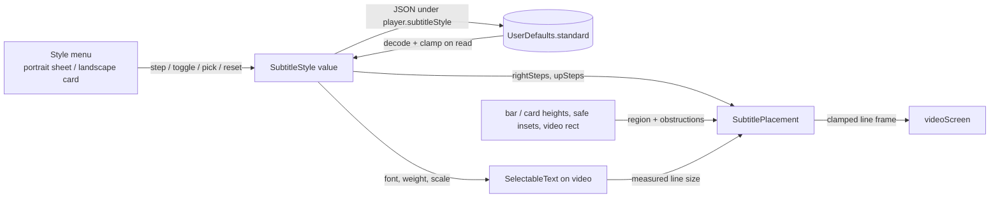

# Subtitle style: font, bold, size and position of the on-video line

* Author: bman7222 (drafted by loop-planner)
* Status: Accepted (Brent, 2026-11-20): D-2..D-8 as recommended. D-1 is "both": the three presets plus "More fonts…" (the system font picker). ASS file styles: not now.
* Date: 2026-11-20

## Problem

The subtitle line on the video always uses one look: the system font, bold, Dynamic Type `.title3`, white with a black outline, centred at the bottom (`SelectableText` in `PlayerView.videoScreen`). Brent can't make it bigger for a phone held at arm's length, smaller for long lines, or move it off burnt-in text or an on-screen sign. The only fix today is to change the system text size, and that changes the whole app.

## Goals

* A new button next to the subtitles button opens a style menu in portrait and in landscape. From it Brent can pick the font, turn bold on or off, make the text bigger or smaller one step at a time, move the line up, down, left or right one step at a time, and reset everything to the default.
* Every change shows on the video at once, while the video keeps playing.
* The line always stays on screen: inside the video area and the safe area, in both orientations, also while the landscape controls (or the style menu itself) are showing.
* The style is remembered across launches. The default style looks exactly like today's line.
* Every control has a distinct icon in the app's existing colours, a spoken label and value, and the menu works with Dynamic Type, VoiceOver and Reduce Motion.

## Non-goals

* Styling the subtitle list (portrait cue list, landscape side panel), the card editor's sentence, or the subtitle browser preview. Only the line on the video changes.
* Using the styles inside ASS files (fonts, colours, `\pos`, margins). The parser strips all of that today, and that stays. See "ASS files" below.
* Text colour, outline colour or width, background box, opacity, line spacing. A later goal can add these.
* A style per show or per episode (see D-2). The timing offset stays per episode, as it is now.
* Bundling or downloading fonts. "More fonts…" lists only what iOS already has installed (system fonts and fonts added through Settings › General › Fonts).
* Italic or other faces from the picker. Families only (`includeFaces = false`); the Bold switch chooses the weight.
* Changing the timing offset sheet (`player.offset`). It keeps its name. This feature calls the new setting "position" everywhere, never "offset", so the two can't be confused.

## User journeys

### J-1: Make the line bigger in portrait
* Given: Brent is watching in portrait with the default style.
* When: he taps the style button (`textformat`, "Aa") next to the subtitles button and taps "larger text" three times.
* Then: a sheet rises over the bottom screen, and the video and its line stay visible above it. The line grows with each tap, and the sheet shows "130%". He swipes the sheet down or taps Done. After relaunching the app, the line is still 130%.

### J-2: Move the line off a sign in landscape
* Given: landscape playback, controls hidden, with burnt-in text at the bottom of the picture.
* When: he taps the video, taps the style button in the bottom bar, and taps "up" four times.
* Then: a style card pops up from the bottom of the video column in place of the bottom bar, and the top bar stays. The line rises 5% of the video area per tap, and is pushed above the card while the card shows. The controls don't auto-hide while the card is open. He taps Done (or taps the video), the card closes, the controls fade 3 s later, and the line rests 20% higher than before.

### J-3: Change font and weight
* When: he taps "Serif" and turns Bold off.
* Then: Japanese text switches to Hiragino Mincho, Latin text to New York, both in the regular weight. The selected font chip and the Bold control show their state (aqua when on).

### J-8: Pick any installed font (T-017)
* Given: the style sheet, or the landscape card, is open.
* When: Brent taps "More fonts…", picks "Georgia" in the system font picker, and later deletes a downloaded font he had picked.
* Then: the line uses Georgia for Latin text. Japanese text falls back to the Hiragino face that matches Georgia's closest preset (Serif, so Hiragino Mincho), never to tofu or a font iOS chooses. The sheet shows "Georgia" with the sample "Aa あア漢字" drawn the way the line will draw it. If the picked font is missing at the next launch, the style quietly becomes Sans with nothing else changed, and the app doesn't crash.

### J-4: Hit a limit
* When: he keeps tapping "larger text" past 200%, or "up" past the top of the video area.
* Then: the size stops at 200% and that button is disabled (dimmed, VoiceOver says "dimmed"). The line never leaves the video area: once it reaches the top edge it stops there, even though the stored step can go up to 90%.

### J-5: Reset
* When: he taps Reset.
* Then: font Sans, Bold on, 100%, centred at the bottom: the line looks exactly as it does today. Reset is disabled while the style is already the default. The style button in the player is aqua (active) whenever the style isn't the default, like the timing offset button is when the offset isn't 0.

### J-6: Rotate, or the controls come and go
* Given: a style with the line moved up 10% and left 10%.
* When: he rotates, and the landscape controls show and hide.
* Then: the line keeps the same relative place on the video (10% of that orientation's video area). The bars only push it when they would cover it: a line already clear of the bottom bar doesn't move when the controls appear. Rotating closes the style menu.

### J-7: VoiceOver and large text
* Given: VoiceOver is on (landscape controls then stay up), or the text size is an accessibility size.
* Then: each control reads as, for example, "Larger text, button, 130 percent", "Move subtitles up, button, 20 percent up", "Bold, on", "Serif font, selected". In portrait the sheet scrolls, so every control can be reached. The subtitle line itself still follows Dynamic Type, multiplied by the chosen size.

## Technical design

### Style value (T-014 owns this contract; T-015 and T-016 only call it)

Lives in `ios/ClipDeck/Features/Player/` (a Player feature value, like the panel fraction).

* `enum SubtitleFont: String, Codable, CaseIterable { case sans, rounded, serif }`
  * `sans`: system font (SF Pro; Japanese falls back to Hiragino Sans W3/W6). This is today's look.
  * `rounded`: `.rounded` design, with a cascade to `HiraMaruProN-W4` for Japanese. Hiragino Maru Gothic has only one weight, so Bold thickens Latin text only. Accepted (D-1).
  * `serif`: `.serif` design (New York), with a cascade to `HiraMinProN-W3` (regular) or `HiraMinProN-W6` (bold) for Japanese.
  * UI names: "Sans", "Rounded", "Serif".
* `struct SubtitleStyle: Codable, Equatable, Sendable` with Int steps, so there is no floating-point drift:
  * `font = .sans`, `bold = true`
  * `sizeStep: Int = 0` in `-4...10`, so scale = 1 + 0.1 × step = 60%...200%
  * `upSteps: Int = 0` in `0...18`, each step 5% of the region height. 0 is the default bottom place, and nothing goes lower.
  * `rightSteps: Int = 0` in `-8...8`, each step 5% of the region width. Negative = left.
  * `static let default`, `isDefault`, the ranges as static constants, and mutators that clamp and report whether a further step is possible (used to disable buttons).
  * Stored as one JSON string under the `UserDefaults.standard` key `player.subtitleStyle`. An empty, unreadable or partial value decodes to the default for each missing or invalid field, and every field is clamped on read. Don't make the type `RawRepresentable` and `Codable` at once: the synthesized Codable then goes through `rawValue` and recurses forever. Use a separate wrapper or a plain `String` `@AppStorage` with explicit encoding.
* Font builder: given the style and a `UIFont.TextStyle` (`.title3`), it returns a `UIFont` scaled by `UIFontMetrics` × the size scale, with the weight `.bold` or `.regular`. The point size is capped at a quarter of the region height (floor 12 pt).

### Picked font (T-017 adds it to the contract; the change is additive, so old JSON still decodes)

* The new field is `pickedFontName: String?`, the PostScript name of the family's regular face that `UIFontPickerViewController` returned (`includeFaces = false`).
  * When it is set, it takes the place of `font`. Picking a preset clears it.
  * `isDefault` requires it to be nil.
* Missing font: on read, if `UIFont(name:size:)` returns nil for the stored name (for example a downloaded font that was deleted), the field is dropped and the style uses Sans. Everything else is kept, nothing is logged to the user, and the app doesn't crash.
* Closest preset of a picked font. This is a pure function of the font's names and symbolic traits, and the first match wins:
  1. the family or PostScript name contains "Mincho" or "Serif" (and not "Sans") → Serif;
  2. it contains "Rounded" or "Maru" → Rounded;
  3. the descriptor's family class (`symbolicTraits` & `.classMask`) is one of the serif classes (old-style, transitional, modern, Clarendon, slab, freeform) → Serif;
  4. anything else → Sans.
* Japanese fallback, so there is no tofu and the result is always the same:
  * the picked font gets an explicit cascade list (`UIFontDescriptor.AttributeName.cascadeList`) to the closest preset's Hiragino face: Sans → `HiraginoSans-W3`/`-W6`, Serif → `HiraMinProN-W3`/`-W6`, Rounded → `HiraMaruProN-W4`, with the W6 face when Bold is on;
  * a picked font that already has Japanese glyphs (for example Klee, or a Hiragino family) uses its own glyphs, because the cascade only fills in glyphs that are missing;
  * the presets use the same faces in their cascades (Sans may keep the system cascade, which is Hiragino Sans).
* Bold with a picked font:
  * Bold on uses the family's bold face (`withSymbolicTraits(.traitBold)`) if the family has one;
  * if it doesn't, the regular face is drawn unchanged (no fake bold), and the Japanese fallback still follows Bold (W6, except Maru);
  * the portrait sheet then shows the caption "This font has no bold weight." under the picked font's row.
* Seed: `-uiTestingSubtitleStyle` accepts `pickedFontName` like any other field.

### Placement (pure function, unit-tested)

Inputs: the video rect (the player view's frame in that orientation), the resting region, the obstructions, the measured line size, `rightSteps` and `upSteps`.

* **Resting region** = the video rect inset by today's margins: leading and trailing `Spacing.l` + the landscape edge insets (the same `edgeInsets` the line uses today, including `panelHandleClearance` while the panel is open); bottom `Spacing.m` + the bottom safe inset (landscape); top `Spacing.s` + the top safe inset (landscape). In portrait the insets are 0.
* **Wanted frame:** centre x = region.midX + rightSteps × 5% × region.width; bottom = region.maxY − upSteps × 5% × region.height.
* **Active region** = the resting region, with its top raised to below the top bar (`topBarHeight + Spacing.s`) and its bottom raised to above the bottom bar or the landscape style card (`height + Spacing.s`) while they show. So the bars only push the line when they would cover it, and the default line sits exactly where it sits today, both with the controls hidden and with them shown.
* **Clamp:** the line's width is at most the region width. The frame is moved fully inside the active region. If it is taller than the active region, its bottom is pinned to the active bottom (only then can the top clip at the video edge).
* The line's frame must hug the text. Today `SelectableText.sizeThatFits` returns the full proposed width, so horizontal moves and frame checks need the used text width. The UI tests read the `player.subtitle` text view's frame as proof.

### Menu (T-015 portrait, T-017 More fonts, T-016 landscape)

* **Opener:** `player.subtitleStyle`, a `Button` (not a `Menu`; see Learned) with `textformat` in `DeckIconButtonStyle(isActive: !style.isDefault)`, placed right after `player.subtitlesMenu` in `transportButtons`, so it sits next to it in the portrait controls row and in all three landscape `ViewThatFits` rows. Label "Subtitle style".
* **Controls** (shared view, identifiers `subtitleStyle.*`):
  * fonts `subtitleStyle.font.sans|rounded|serif`, each drawn in its own font with Japanese and Latin together: the sample "Aa あア漢字" in the portrait rows, "Aあ" on the landscape chips;
  * `subtitleStyle.font.more` (T-017): "More fonts…", icon `ellipsis.circle`, opens the system font picker. In portrait its row shows the picked font's name and the sample in it. It is aqua (selected) while a picked font is in use;
  * `subtitleStyle.bold`: SF Symbol `bold`, a toggle;
  * `subtitleStyle.sizeDown` (`textformat.size.smaller`) and `subtitleStyle.sizeUp` (`textformat.size.larger`);
  * `subtitleStyle.up|down|left|right`: `arrow.up|down|left|right`. Not chevrons, because `chevron.left` is Back;
  * `subtitleStyle.reset`: `arrow.counterclockwise`;
  * `subtitleStyle.done`: `checkmark`.
  * No two controls share an icon.
* **Colours:** only the existing tokens. Idle = Shell fill and Ink glyph (`DeckIconButtonStyle`). Selected or on = Accent fill and white glyph. Values and captions = InkSoft. Disabled = 0.45 opacity, the value `DeckPrimaryButtonStyle` already uses; `DeckIconButtonStyle` gains this disabled look. In landscape the card uses the bars' look: `Color.black.opacity(0.55)` with a `.dark` colour scheme. No new colours or assets.
* **Portrait:** a sheet (`presentationBackground(Theme.panel)`), with a fixed-height detent that leaves the video uncovered on iPhone 17 Pro at the default text size, plus `.large`. Its content scrolls. Layout, top to bottom:
  * header "Subtitle style" and Done;
  * Font: one row per preset (the name and the sample "Aa あア漢字" in that font, selected = aqua), then "More fonts…" (T-017), then Bold;
  * Size: [smaller] "100%" [larger];
  * Position: the four arrows, with a value line such as "Up 20% · Left 10%" or "Default place";
  * a full-width "Reset to default".
  * The system sheet animation is used, which follows Reduce Motion.
* **Landscape:** a card (`subtitleStyle.card`) docked to the bottom of the video column, in place of the bottom bar while it is open. The top bar stays. Its layout comes from `ViewThatFits`: one row of 13 icon controls (12 plus More fonts), otherwise two rows of 7 and 6, otherwise three rows of 5, 4 and 4. It is icon-only, and the values are spoken. It appears with move-from-bottom + opacity, or opacity only under Reduce Motion (`accessibilityReduceMotion`). Open state is `@State styleMenuOpen`, which is part of `keepsControlsUp`, and so is the font picker's presented state. Done, a tap on the video, or a rotation closes it, and closing restarts the hide timer.

### Launch flags (Debug, `-uiTesting` only)

* Every `-uiTesting` launch removes `player.subtitleStyle` (like `player.panelFraction`), unless `-uiTestingKeepSubtitleStyle` is passed.
* `-uiTestingSubtitleStyle <json>` then writes that style. Document both in CLAUDE.md.

### ASS files

`SubtitleParser.parseASS` reads only the `[Events]` Dialogue lines and `cleanASS` strips every `{...}` override block. The `[V4+ Styles]` section, the Style, MarginL/R/V fields, `\pos` and `\an` are ignored. So ASS lines are already drawn exactly like SRT lines, and the user style applies to them in the same way. There is no conflict to resolve. Honouring ASS styles is a separate future goal.

### Docs

* ARCHITECTURE.md: the `player.subtitleStyle` key and the placement rule.
* PRODUCT_SPEC.md: the feature, plus the "global, remembered" assumption.
* DESIGN.md: the menu in both orientations, its icons, motion and accessibility.

## Decisions

| ID | Decision | Chosen (recommended) | Instead of | Why | Cost |
|---|---|---|---|---|---|
| D-1 | Fonts | Both (Brent): Sans (default), Rounded, Serif presets, plus "More fonts…" (`UIFontPickerViewController`). Every font cascades to a fixed Hiragino face for Japanese | Presets only | It's a Japanese and English app: presets cover both scripts, and the picker gives choice without risking tofu | Rounded and Maru fallbacks have no bold Japanese weight; a picked family may have no bold |
| D-2 | Scope | One global style for the whole app | Per show | It's a reading preference, not a property of a file (unlike the timing offset) | Can't differ per show |
| D-3 | Size steps | 10% per tap, 60%–200%, on top of Dynamic Type | Fixed point sizes | Keeps Dynamic Type; percentages read well | — |
| D-4 | Position unit | 5% of the video area per tap; up 0–90%, sideways ±40%; can't go below the default bottom place | Points | Same relative place in portrait and landscape | Long lines can barely move sideways |
| D-5 | Portrait menu | Bottom sheet over the controls and cue list; video visible | Popover from the button | Familiar (like the timing offset sheet), scrolls at large text | Covers the cue list while open |
| D-6 | Landscape menu | Card docked in place of the bottom bar; the line is pushed above it like it is above the bar | Popover (covers the line) or sheet (full height, covers the video) | The line stays visible and live while adjusting | The bottom bar is hidden while the card is open |
| D-7 | Default | Sans, Bold on, 100%, bottom centre (today's look) | — | Nothing changes until Brent changes it | — |
| D-8 | Opener state | Aqua (active) when the style isn't the default | Always idle | Matches the timing offset button | — |

## Risks and rollout

* A stored style from a future or past build must never crash or push the line off screen, so it is clamped on read and clamped again at layout.
* The landscape bottom bar is already tight with the panel at 50% (about 245 pt of about 320 pt used). The new 44 pt button plus 8 pt spacing brings it to about 297 pt. T-016 must prove the button fits at 50% on iPhone 17 Pro.
* There is no migration, because the key is new. To roll back, revert. A leftover key is ignored.

## Acceptance

| ID | Done when | Proves | How to check |
|---|---|---|---|
| AC-1 | The default style renders the line where it is today, in both orientations, with the controls hidden and shown | D-7, J-6 | T-014 UI tests (frames vs the video and bars) |
| AC-2 | A seeded non-default style changes the font, weight, size and place of the line and survives relaunch | J-1, J-3 | T-014 unit + UI tests |
| AC-3 | No style and no bar state can put any part of the line outside the video area or the safe area | J-4, J-6 | T-014 placement unit tests + extreme-style UI test |
| AC-4 | The portrait style sheet changes the line live and leaves the video visible | J-1, J-3, J-5 | T-015 UI test |
| AC-5 | The landscape style card fits at panel 50%, keeps the controls up while playing, pushes the line, and closes on Done, a tap on the video, or a rotation | J-2, J-6 | T-016 UI tests |
| AC-6 | Each control has a distinct icon, the app's colours, a label and value; disabled at limits; Reduce Motion is honoured | J-4, J-7 | T-015/T-016 UI tests + screenshots |
| AC-7 | A picked font draws Latin text in itself and Japanese in the closest preset's Hiragino face (never LastResort/tofu); a missing picked font becomes Sans without a crash | J-8 | T-017 unit tests (CoreText runs) + seeded UI test |

## Open decisions

* None. D-1..D-8 were settled by Brent on 2026-11-20. ASS file styles: not now, maybe a later goal.
