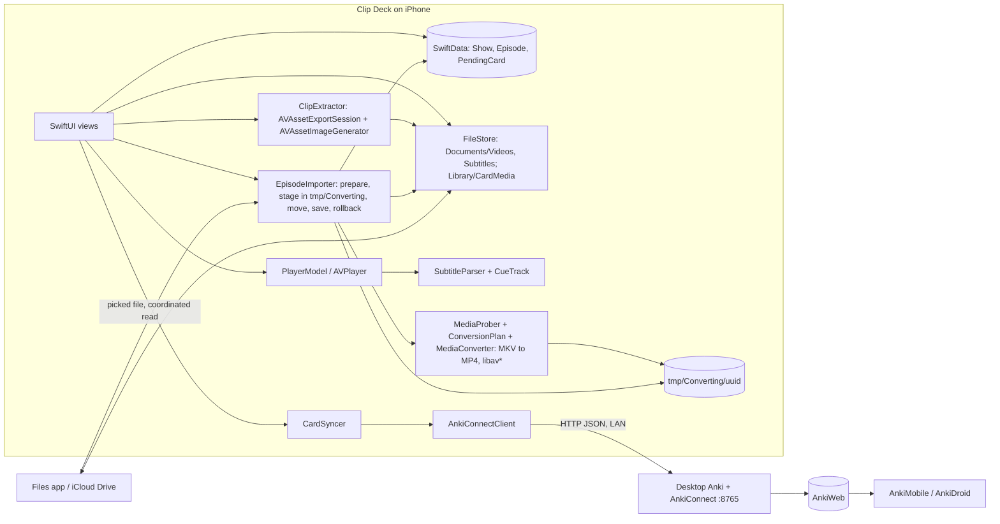

# Clip Deck: architecture

Created with the `iphone-app-setup-skill` skill.

## Overview

Clip Deck is a single native SwiftUI app with no server of its own. Everything works offline. The only network traffic is the user-started Sync, which calls the AnkiConnect add-on on the user's computer, and the user-started JMdict download in the Dictionaries sheet (one HTTPS GET to GitHub; dictionary lookups never use the network).

## Frontend

- **Framework:** SwiftUI, iOS 17.0+, SwiftData, AVFoundation, XcodeGen.
- **Language:** Swift 6 with MainActor default isolation in the app target. AVFoundation is imported with `@preconcurrency` where non-Sendable types cross `await`s.
- **Entry point:** `App/ClipDeckApp.swift`. It sets up:
  - the SwiftData container (in-memory under `-uiTesting`);
  - `SettingsStore` in the environment;
  - the Documents folders;
  - the `.playback` audio session.

  `App/RootView.swift` shows `LibraryView`, after seeding sample media in Debug UI tests.
- **Navigation:** one `NavigationStack` at the library. It pushes `Show` (episode list) and `Episode` (player, or the missing-file screen). Upload, Sync, Anki settings, subtitle picker, offset and card editor are sheets.
- **Features (`Features/`):**
  - Library;
  - Player: `PlayerModel` is `@Observable` and owns the `AVPlayer`, a 20 Hz time observer, the current cue, the offset, and `playSegment`;
  - CardEditor;
  - Sync;
  - Settings.
- **Design system:** `DesignSystem/` (tokens, `DeckTile`, button styles, `ErrorBanner`, `Toast`). `SelectableText` is a `UITextView` wrapper that makes subtitle text selectable so iOS **Look Up** works. Details in DESIGN.md.
- **Persistence:**
  - SwiftData for the library and the card queue;
  - UserDefaults (JSON) for Anki settings;
  - UserDefaults for player preferences: `player.panelFraction` (landscape panel width) and `player.subtitleStyle` (below);
  - files in the app sandbox.

  Paths are stored **relative to Documents**, because the container path changes on re-install (which happens every 7 days with a free Apple ID).
- **Clip timeline (`Services/Subtitles/ClipTimeline.swift`):** a pure value type for the Make a Card timeline, in video-time ms and points. It builds the notches (cue edges, offset applied, 1 ms merge; `drawnNotches` also drops those under 2 pt apart), the zoom window (30 s on the clip midpoint, clip length + 20 % past 25 s, shifted into [0, duration]; duration falls back to the last cue's end while `videoDurationMs` is 0), x/ms mapping, snapping (in at 10 pt, out past 16 pt, the caller keeps the snapped notch), handle clamps (through `ClipMath.adjusted`, so the 200 ms rule is shared) and the nearest-handle rule with a drag-direction tie-break.
- **Subtitle style (`Features/Player/SubtitleStyle.swift`, `SubtitlePlacement.swift`):**
  - one global `SubtitleStyle` (font Sans/Rounded/Serif, bold, size step -4...10, `up` 0...0.90 and `right` -0.40...0.40 as continuous fractions of the resting region, rounded to 4 decimals on every write; an arrow tap moves 0.05 from wherever the line is, not onto a grid) saved as JSON under the `UserDefaults.standard` key `player.subtitleStyle` (keys `font`, `bold`, `sizeStep`, `up`, `right`, `pickedFontName`). Each field is decoded on its own (missing or invalid fields take the default, unknown fields are ignored) and clamped on read. Old saves with `upSteps`/`rightSteps` still decode (x 0.05) and are written back under the new keys only. `resetFont()` and `resetPosition()` restore the font group (font, picked font, bold, size) and the position separately; `isFontDefault`, `isPositionDefault` and `isDefault` report them. The default is the look the line always had. Japanese falls back to a fixed Hiragino face for Rounded and Serif;
  - placement rule (`SubtitlePlacement.frame`, a pure function): the resting region is the video inset by the margins (`Spacing.l` sideways plus the landscape insets and the open panel's handle clearance, `Spacing.m` plus the bottom inset below, `Spacing.s` plus the top inset above). `up` is a fraction of the region's height, `right` a fraction of its width. While the landscape top or bottom bar shows, the region's top or bottom is pulled in to clear it (bar height + `Spacing.s`), so a bar only moves a line it would cover. The line is then moved fully inside, and a line taller than the region is pinned to its bottom. `SubtitleLineLayout` applies it to a `SelectableText` that hugs its text (`hugsWidth`), so the line's frame is the frame of the visible text;
  - Debug launch flags: see CLAUDE.md (`-uiTestingKeepSubtitleStyle`, `-uiTestingSubtitleStyle <json>`).

## Backend

None. The app needs no server: the user owns all the data, and Anki is the destination. AnkiConnect, running inside desktop Anki, plays the role of an API.

## Data and access control

**SwiftData models** (`Models/Models.swift`):
- `Show`: name (unique), colour. Cascade-deletes its episodes.
- `Episode`:
  - title and number;
  - `videoPath` and `subtitlePath` (relative);
  - `offsetMs` and `lastPositionMs`.
- `PendingCard`:
  - id and source;
  - clip range;
  - fields as JSON;
  - media file names;
  - status: `pending` / `synced` / `failed` / `duplicate`;
  - Anki note id and last error.

**Files** (`Services/FileStore.swift`):
- `Documents/Videos/<Show>/<Episode>.<ext>`;
- `Documents/Subtitles/<Show>/<Episode>/<file>`, visible in the Files app;
- `Library/CardMedia/clipdeck_<card-id>.m4a|.jpg`, private;
- `tmp/Converting/<uuid>/`, private staging for an import in progress (see "Importing episodes"). Swept at every launch.

**Access control:** everything is in the app sandbox. AnkiConnect access can require the optional API key set on both sides.

## Communication

`AnkiConnectClient` (`Services/Anki/`) posts `{action, version: 6, params, key}` JSON to the address the user enters, with an 8 s timeout. It uses these actions:
- `version`, `deckNames`, `modelNames`, `modelFieldNames`;
- `storeMediaFile` (base64);
- `addNote` (`allowDuplicate: false`, `duplicateScope: deck`).

Error handling:
- A transport failure becomes `AnkiError.unreachable`, with setup advice.
- AnkiConnect's `error` string becomes `AnkiError.anki`. Duplicates are detected from that message.

`CardSyncer` sends queued cards oldest-first:
- It uploads media under stable per-card names, so a retry overwrites instead of duplicating.
- It maps fields through the user's field map, HTML-escapes text and turns newlines into ` `.
- It records per-card results.
- It stops at the first "unreachable" error so the remaining cards stay queued.

## Configuration and secrets

| Value | Where it lives | Public? |
|---|---|---|
| AnkiConnect address | In-app Anki settings (UserDefaults) | Yes (a LAN address) |
| AnkiConnect API key (optional) | In-app Anki settings (UserDefaults) | No. A shared password with the user's own Anki, stored on the device; never in the repo |
| Deck, note type, field map, tags, audio padding | In-app Anki settings | Yes |
| Bundle id, display name | `ios/project.yml`, `ios/Config/Shared.xcconfig` | Yes |

The build has no secrets. `.env.example` and `Secrets.example.xcconfig` are unused scaffold placeholders.

## FFmpeg (MKV import, in progress)

The app links FFmpeg to convert MKV files to MP4 on import (spec: `.loop/specs/mkv-import.md`). T-012 added the libraries, the test fixtures and the licence notices; T-004 added the converter (below); T-006 added `EpisodeImporter` and the upload/relink flow ("Importing episodes"). T-005 added built-in subtitle extraction (backend: below; the upload sheet row and player list are the frontend half).

| Item | Value |
|---|---|
| Package | `superuser404notfound/FFmpegBuild`, `exactVersion: 3.16.0` in `ios/project.yml` (tag commit `7de456f9b6efea4d6c8c6617cc77e7c79cb1e280`) |
| Backup | Fork `bman7222/FFmpegBuild` (made 2026-11-19, tag `3.16.0` = `7de456f`). The app still builds from upstream. If upstream disappears, change the package URL in `ios/project.yml` to the fork. |
| FFmpeg | n8.1.3 (commit `1041abdc962f4cc4f394aa8de9dc5236c0c3b9e7`), a few local patches listed in the package README |
| Licence | LGPL-2.1-or-later; built without `--enable-gpl`, `--enable-version3`, `--enable-nonfree`. See `THIRD_PARTY_NOTICES.md` |
| Linked products | `AetherLibavformat`, `AetherLibavcodec`, `AetherLibavutil`, `AetherLibswresample`, plus the link-only `AetherLibdav1d` and `AetherLibzvbi` that libavcodec and libavformat load at launch (`@rpath`). Without them the app would not start |
| Binaries | Dynamic xcframeworks **committed in the package's git repo** (path binary targets, no download URLs or SPM checksums). The tag is the pin; the sha256 of every shipped binary is in the package's `BUILD-INFO.txt` at that tag. A tag can be moved, so the commit above is the real identity. Forking or mirroring the repo at the tag would keep the bytes if the package vanishes (needs Brent's OK) |
| Size | iOS device slices: avcodec 6.07 MB, avformat 1.12 MB, avutil 0.75 MB, swresample 0.14 MB, dav1d 0.83 MB, zvbi 0.52 MB, about 9.4 MB in total |
| Not in the build | Matroska, SRT and ASS muxers, so MKV test files come from Homebrew FFmpeg. The only AAC encoder is the native `aac` (no `aac_at`) |

Rules:
- Libav pointers stay inside one synchronous function; only Sendable values cross (`FFmpegInspector` is the model). The app target defaults to MainActor, so the converter must be `@concurrent` or run in `Task.detached`.
- `FFmpegSupport` holds the values of FFmpeg's function-like macros (AVERROR_EOF, MKTAG, AV_NOPTS_VALUE, flag bits), which don't import into Swift. Check new ones against the headers in the pinned package.
- The unit tests import no FFmpeg module: they call app-side helpers, which keeps the C modules out of the test target.
- The bundled licence texts live in `ios/ClipDeck/Resources/Licenses/` (a folder reference, so they sit in the app at `Licenses/`). `ClipDeck-LICENSE.txt` must equal the root `LICENSE`; `scripts/check-ipa-notices.sh` (the `ipa` CI job) checks that and the other texts inside the built IPA.
- Changing the FFmpeg version means updating `project.yml`, the notice, `THIRD_PARTY_NOTICES.md` and the check script's tag URL together.

### MKV conversion (`Services/Media/`)

| Piece | What it does |
|---|---|
| `MediaProber.read(url:)` / `load(url:)` | Opens the file with libavformat and returns a `MediaProbe`: container, duration, start time; video codec, profile, pixel format, bit depth, chroma, size, Dolby Vision profile, start and offset; every audio track (codec, language, title, channels, sample rate, start and offset, default flag, decoder available); every subtitle track (codec, language, title, default, text or picture). Cover-art streams are skipped. `load` is cancellable (same cancel flag and interrupt callback as the converter) |
| `ConversionPlan.make(probe:audioStreamIndex:supportsAV1:)` | Pure. Applies the allow-list and audio rules, or throws `UnsupportedMediaError` with a message that names the format and suggests HandBrake |
| `MediaConverter.convert(source:plan:to:progress:)` | Writes one MP4 at the given URL (which must not exist; its folder must). Deletes it on failure or cancel. Returns a `Report` |
| `MediaConverter.makeStagingFolder()` | Creates `tmp/Converting/<uuid>/`. `EpisodeImporter` moves results out on success and sweeps the folder at launch |

Video allow-list (stream copy only): H.264 4:2:0 8-bit; HEVC Main/Main 10, 4:2:0 8/10-bit, written as `hvc1`; Dolby Vision 8.x (and any profile with a compatible base layer) as its HEVC base layer, with the Dolby Vision record dropped; AV1 4:2:0 8/10-bit only when `supportsAV1`. Everything else is rejected, including Dolby Vision 5, 4:2:2, 4:4:4, 12-bit, H.264 10-bit, VP9, MPEG-4 Part 2, MPEG-2 and VC-1.

Audio: one track (the user's choice, else the default-flagged one, else the first). AAC or MP3 with 1-2 channels is copied. Everything else (including AAC 5.1) is decoded, downmixed with swresample and encoded with FFmpeg's native `aac` encoder: AAC-LC, stereo, 192 kbit/s, the source rate capped at 48 kHz (snapped to an AAC rate). Damaged audio packets or frames are skipped, as ffmpeg does, and counted in `Report.warnings`; past 50 errors that are more than 1 in 10 audio packets, the import fails as a damaged file. Subtitle streams are never written into the MP4. Streams the plan names in `ConversionPlan.subtitles` (text SRT/WebVTT/ASS/SSA, asked for through `EpisodeImportOptions`) are read in the same pass instead of discarded, and written as files in Swift (the FFmpeg build has no srt or ass muxer): SubRip and WebVTT packets become `.srt`; ASS/SSA become `.ass` from the track's CodecPrivate header plus `Dialogue:` lines rebuilt from the Matroska blocks (`ReadOrder,Layer,Style,Name,MarginL,MarginR,MarginV,Effect,Text`) and their times, in ReadOrder order (`SubtitleFileWriter`). Times are the packet times, so they are on the MP4's clock. Picture tracks (PGS, VobSub, DVB) are never extracted; they are listed as unusable. Names are `<n> <language> <title>.<ext>`.

**Concurrency rule.** The app target has `SWIFT_DEFAULT_ACTOR_ISOLATION: MainActor` and `SWIFT_APPROACHABLE_CONCURRENCY`, so a plain `nonisolated async` function runs on the caller's actor. `MediaConverter.convert` and `MediaProber.load` therefore run a synchronous core in `Task.detached`. Every libav pointer is created, used and freed inside that core (`ConversionCore.run` / `ConversionSession`, `MediaProber.read`); only Sendable values cross: URLs, the probe, the plan, progress doubles and the report. Cancellation: `withTaskCancellationHandler` sets a `ConversionCancelFlag` (an `OSAllocatedUnfairLock<Bool>`, since `Mutex`/`Atomic` need iOS 18). The packet loop checks it on every packet, and libavformat's `AVIOInterruptCB` checks it during blocking reads and writes, so a cancel stops within about a second and throws `CancellationError`. Progress is a `@Sendable (Double) -> Void` called on the conversion thread, 0 once the output is open, rising at most every 0.1 s (`ProgressThrottle`), 1 at the end; UI code hops to the main actor itself.

**Timeline rule.** MP4 time t = source time t. Nothing is rebased: packets keep their source timestamps (only rescaled with `av_packet_rescale_ts`), and the mp4 muxer (`AVFMT_TS_NEGATIVE`, so `avoid_negative_ts` is off) turns a positive stream start into an empty edit and trims a negative one (AAC priming, B-frame delay) with an edit list (`use_editlist=1`). So a 1.0 s start offset and a 0.5 s audio delay survive as edit lists, and subtitle files made for the MKV stay in sync. Transcoded audio takes its clock from the first decoded frame and counts samples from there. Packets follow FFmpeg's `remux.c`: rescaled timestamps, `av_interleaved_write_frame`, and a strictly increasing DTS per stream (`TimestampFixer` repairs broken files the way the ffmpeg command line does; well-formed files pass unchanged). A timestamp beyond ±2^60 is rejected as a damaged file, and the repairs use comparisons and wrapping adds, because a Swift overflow would crash the app on a hostile file. No `+faststart`: it rewrites the whole file and doubles the I/O.

### Importing episodes (`Services/EpisodeImporter.swift`, `Services/SourceAccess.swift`)

Every video the user adds or re-links goes through `EpisodeImporter`, in two steps (spec › Import, files and lifecycle):

1. **Prepare** (`prepare(_:onStage:)`), when the file is picked. Nothing is written.
   - Extension check: `mp4`, `mov`, `m4v` are copied; `mkv` is converted. Anything else is refused with "“.xyz” videos aren't supported. Use MP4, MOV, M4V or MKV."
   - iCloud: if `ubiquitousItemDownloadingStatus` isn't current, `startDownloadingUbiquitousItem`, then `onStage(.downloadingFromICloud)`.
   - `SourceAccess` holds security-scoped access and an `NSFileCoordinator` coordinated read **from prepare until the import ends**. The coordinated read is what makes iCloud Drive (or another file provider) download the file before it is read, and keeps the file from being replaced mid-read. The coordinator only grants access inside a synchronous block, so a dedicated thread waits inside that block until `close()` (or the last reference goes away). Cancelling the prepare task cancels the coordinator.
   - Free space: `volumeAvailableCapacityForImportantUsage` must be at least the source size + max(10 %, 200 MB) (`StorageSpaceRule`, decimal units), else "This needs about 1.6 GB free; you have 0.9 GB." Checked again when the import starts.
   - MKV only: `onStage(.probing)`, `MediaProber.load`, and the plan for the default audio track (`ConversionPlan.defaultAudioTrack`; if that track has no decoder, the first track that works). Unsupported video is refused here with the plan's message.
   - The result, `PreparedVideo`, lists the audio tracks and builds the plan for another choice (`plan(for: EpisodeImportOptions)`).
2. **Import** (`importEpisode(_:as:options:into:progress:)`, or `relink(_:to:options:in:progress:)` for "Choose the video again").
   - **Stage:** a fresh `tmp/Converting/<uuid>/`. MKV is converted there (`MediaConverter.convert`); MP4/MOV/M4V is copied there; the subtitle file is copied there with a coordinated read. Nothing in Documents changes while this runs. Progress reaches the caller on the main actor and never goes backwards (`ProgressRelay`).
   - **Commit:** move the staged files into `Videos/<Show>/` and `Subtitles/<Show>/<Episode>/` with `FileStore.uniquePath` (a rename: tmp and Documents are on the same volume), then insert the Episode (and a new Show) or update `videoPath`, then save.
   - **Rollback:** if a move or the SwiftData save fails, the moved files are deleted, the folders this import created are removed if empty, the inserted models are deleted (or the old `videoPath` restored), and the error is thrown. This also covers the MP4 path, where a failed save used to leave orphaned files.
   - **Cancel:** cancelling the import task stops a conversion within about a second (`CancellationError`); the staging folder is deleted on every exit. An MP4 copy can't be interrupted, so it finishes into staging and is then deleted.
   - **Crash or kill:** the half-written files are only ever in `tmp/Converting/`, and `ClipDeckApp` calls `EpisodeImporter.sweepStaging()` at every launch before any import can start.
   - Success closes the `SourceAccess`; a failure keeps it open so the user can retry without picking the file again.
- `EpisodeImportOptions` holds the choices made between the two steps (the audio track; the built-in subtitle tracks to extract; which one becomes the episode's subtitle). The default extracts nothing. Extracted files are written to `tmp/Converting/<uuid>/Embedded/`, moved into `Subtitles/<Show>/<Episode>/` with the user's own file, and rolled back the same way. A subtitle file the user picked wins as the episode's subtitle; the extracted tracks are still saved, so they appear under "Load different subtitles".
- Screen lock and background (upload sheet and `MissingFileView`): `isIdleTimerDisabled` is on while converting, and a `beginBackgroundTask` covers short trips out of the app; when it expires, the import task is cancelled and the sheet says "Conversion stopped. Keep Clip Deck open until it finishes."
- Possible follow-up: `BGContinuedProcessingTask` (iOS 26+) could let a conversion continue for minutes in the background. It is not used: untested on a free sideload, and the app targets iOS 17.
- The `-uiTesting -uiTestingMKV` launch arguments (Debug) seed "MKV Show / Episode 1" by importing fixture 4 from `CLIPDECK_FIXTURES` through this same importer.

## Dictionary store (`Services/Dictionary/`)

Offline dictionaries for Lookup Mode (spec `.loop/specs/player-lookup-timeline.md`, Feature 3). T-026 is the store and the importer; T-028 is the manager screen (`Features/Dictionaries/`).

- `DictionaryManagerModel` (`@Observable`, created in `ClipDeckApp`, in the environment) holds the installed list and runs imports. List edits (order, switch, delete) change the list at once and are written to the store in order (`finishWrites()` waits for them). `importFile(_:)` reads a picked zip through `SourceAccess` (security-scoped, coordinated) and the importer; `downloadJMdict()` streams the JMdict English zip (`URLSession.bytes`, 64 KB chunks, progress from Content-Length) to a temp file, imports it, and deletes the file whether it succeeds, fails or is cancelled. One run at a time; Cancel stops either phase and shows nothing. Under `-uiTesting` the store is an empty temporary database (`-uiTestingDictionary` fills it from `$CLIPDECK_FIXTURES/dictionaries`).

- `SQLiteDatabase` / `SQLiteStatement`: a thin wrapper over the system `SQLite3` C API (no ORM, no SwiftData). Prepared statements are reused, `transaction {}` commits or rolls back. Neither type is thread-safe.
- `DictionaryStore` (an `actor`) owns the one connection, in `Library/Application Support/Dictionaries/dictionaries.sqlite` (or a URL given to `init(url:)`). WAL, `synchronous=NORMAL`, `PRAGMA user_version` = schema version (1; a newer file is refused).
- Schema: `dictionaries` (id, title, revision, format, kind `words|frequency`, priority, enabled, attribution, frequency_mode, term/meta/tag counts, bytes; unique on title + revision), `terms` (dict, expression, reading, def_tags, rules, score, sequence, term_tags, glossary = zlib-compressed JSON; indexed on expression and on reading), `term_meta` (dict, term, mode, data = the raw JSON; `freq` rows only; indexed on term), `tags`. Rows are removed by hand when a dictionary is deleted (no foreign keys).
- API: `importDictionary(from:progress:)`, `dictionaries()` (by priority), `setPriorityOrder(_:)` (the ids named come first, the rest follow in their old order), `setEnabled(_:_:)`, `delete(_:)`, `terms(matching:)` (rows of the enabled dictionaries whose expression or reading is one of the strings, by dictionary priority then score; `glossaryJSON` is decompressed, T-029 renders it).
- `YomitanImporter` reads formats 1 to 3 (`index.json` with `format` or the old `version`; v1 term rows keep the glossary as the elements after the score). It keeps term banks, `freq` rows of term-meta banks and tag banks, and ignores kanji banks and pitch/IPA rows. The store runs it inside one transaction, one bank file at a time, with ZIPFoundation. Progress is the share of bank bytes done (0 at the start, 1 at the end); cancellation (`CancellationError`) is checked between banks and every 1,000 rows. A failure or cancel rolls everything back, including the `dictionaries` row. A new dictionary goes last in priority. Refused, with nothing written: a duplicate title + revision, no `index.json`, a format outside 1 to 3, a corrupt zip or bank file, a zip with no words and no frequency rows (`DictionaryImportError`).
- Frequency data (`term_meta.data`) can be a number, a string, or an object (`{value, displayValue}` or `{reading, frequency}`); `LookupEngine` interprets it.
- Tests: `DictionaryStoreTests` reads the zips in `scripts/fixtures/dictionaries/` (checked in, built by `python -I scripts/make-dictionary-fixtures.py`; the data is written for Clip Deck, none comes from Yomitan, which is GPL-3.0).
- Licence: ZIPFoundation (MIT) is pinned in `project.yml`; its notice is in `THIRD_PARTY_NOTICES.md` and `Resources/Licenses/ZIPFoundation-LICENSE.txt` (shown in Settings > About and checked by `scripts/check-ipa-notices.sh`).

### Lookup engine (`Services/Dictionary/`, T-027)

Offline word lookup on top of the store; no screen uses it yet (T-029 to T-031 do). It imports no URLSession.

- `Deconjugator` turns a conjugated word into dictionary forms. The rules are data: `Resources/Dictionary/deconjugation_rules.json` is JL's `deconjugation_rules.json` (Apache-2.0, derived from Nazeka's; commit and licence in `THIRD_PARTY_NOTICES.md` and `Resources/Licenses/Deconjugation-LICENSE.txt`, shown in Settings > About). A rule swaps a conjugated ending for a plainer one and moves the word to a new word class; the search starts from the end of the word, keeps each (text, class) pair once, stops after 7 named steps, and returns only forms that reach a dictionary class. A result is `Deconjugation(text, rule, reasons)`: `rule` is Yomitan's id (v1, v5, vk, vs, vz, adj-i; `v4r`, `v5aru` and the other godan classes become v5, `vs-i/s/c` vs; `cop` has none and keeps its name) and `reasons` the undone conjugations, outermost first (`["past", "negative"]`).
- `LookupEngine(store:deconjugator:)` is a struct of `Sendable` parts; every call is `async` and reaches the database through the store's actor.
  - `scan(text:at:)`: half-width katakana become full width; katakana also becomes a hiragana candidate; `NLTokenizer` (Japanese) moves the start back to the word's start; substrings from there, 16 down to the one that still includes the tapped character, are deconjugated; one `terms(matching:)` query covers every candidate word (expressions and readings); an entry is kept when its `rules` (space-separated) contain the deconjugated rule id, or for a form that wasn't deconjugated. Returns `LookupResult(range, entries)` with `range` the longest match in the original text, or nil.
  - `lookup(exact:)`: the same, for the whole trimmed selection and no substring scan; `range` is the whole text.
  - Ranking: longest match, then the entry's best dictionary priority, then frequency, then the highest score. Frequency is the first value in dictionary priority order, rank-based (lower first) unless that dictionary's `index.json` says `occurrence-based` (higher first); entries with none come last. Entries are grouped by expression + reading; each enabled dictionary gives one section (in priority order), with the frequency of each frequency dictionary beside it (`DictionaryStore.frequencies(matching:)`, a second query). Disabled dictionaries give neither terms nor frequencies.
- The result types are in `LookupResult.swift` (`LookupResult`, `LookupEntry`, `LookupFrequency`, `LookupSection`, `LookupDefinition`, `GlossaryItem`). A glossary item is `.text` or `.structured(Data)` (the JSON object, for T-029's renderer).
- Tests: `LookupEngineTests` (fixtures `lookup-words`, `frequency-rank`, `frequency-occurrence` plus the T-026 ones; a 200k-term generated store, median scan under 50 ms, timings attached as `scan-timings.txt`).

## Decisions

| Area | Decision | Why | Alternatives considered |
|---|---|---|---|
| Frontend | Native SwiftUI, iOS 17 | iPhone-only; AVFoundation gives frame-exact seeking and audio export; Look Up is built in | Expo/React Native (needs native modules for clipping anyway; no gain) |
| asbplayer integration | Re-implemented natively (offset, cue list, partial ranges, re-record, field mapping) | asbplayer is a browser extension/web app and can't run inside an iPhone app offline | Embedding asbplayer's web app in a WebView (no tab-audio capture on iOS; no offline file access) |
| Audio capture | Cut audio from the file (`AVAssetExportSession`, M4A) while the segment plays on screen | Exact and independent of device volume or interruptions; same UX as asbplayer's "record" | Recording the output in real time (impossible to capture app audio without ReplayKit) |
| Video formats | MP4/MOV/M4V are copied and played with AVPlayer; MKV is converted to MP4 on import (`EpisodeImporter` + `MediaConverter`, LGPL FFmpeg build), keeping one audio track; the MKV itself is not kept | Native, reliable seeking and export; one player stack | VLCKit or libmpv for MKV (large dependency; audio export much harder) |
| Import staging | Convert or copy into `tmp/Converting/<uuid>/`, move into Documents only on success, delete moved files if the save fails, sweep `tmp/Converting/` at launch | A cancel, failure, crash or kill can't leave half files or orphans in the library | Writing straight into Documents |
| Anki | Queue on the phone, Sync via AnkiConnect to desktop | User's choice; full fidelity (audio + image + any note type) | .apkg export to AnkiMobile (future option) |
| Dictionary | iOS Look Up + Yomitan-compatible field names | User's choice; zero extra data | Bundled Yomitan dictionaries (future) |
| Project generation | XcodeGen | Text project file, editable from Windows | Committed .xcodeproj |
| Persistence | SwiftData + relative file paths | Simple, local; survives re-install path changes | Core Data, a JSON store |
| ATS | `NSAllowsArbitraryLoads` + `NSAllowsLocalNetworking` | AnkiConnect is HTTP-only and its address is user-entered (LAN IP, `.local`, Tailscale name). The app makes no other requests | Local-networking only (would block VPN hostnames) |
| Builds without a Mac | GitHub Actions macOS runner: simulator tests + unsigned .ipa; Sideloadly installs | Developer has Windows only | Appetize.io (still needs a cloud build; limited minutes) |
| Testing media | Debug-only `TestMediaFactory` generates an MP4 with AVAssetWriter; `scripts/make-test-media.sh` generates five MKV fixtures with Homebrew ffmpeg into `build/fixtures/` | No binary fixtures in git; works on any runner | Committed media files |
| MKV conversion | Stream-copy video, transcode audio only when it isn't AAC/MP3 stereo, keep the source clock with edit lists | Fast (no video encode), exact sync, subtitle files made for the MKV still line up | Re-encode video; rebase everything to 0 |

## Deployment (not yet done)

- **Personal use (now):**
  - unsigned `.ipa` from CI, installed with SideStore (recommended) or Sideloadly;
  - with a free Apple ID: 7-day signing, 3-app limit; SideStore refreshes on the phone (LocalDevVPN + a daily Shortcuts automation), so no computer is needed after setup, see [INSTALL_ON_IPHONE.md](INSTALL_ON_IPHONE.md);
  - SideStore signs the app as `dev.brent.clipdeck.<team ID>`, so a Sideloadly copy is most likely a separate app with its own library. On one free Apple ID (one active certificate), the two tools revoke each other's certificate. The app has no library export/import (Brent decided 2026-11-20 not to add one).
- **TestFlight / App Store:**
  - needs an Apple Developer account ($99/yr), a team id (`DEVELOPMENT_TEAM` in `ios/project.yml`), and signing certificates and profiles stored as GitHub secrets;
  - an `xcodebuild -exportArchive` step;
  - a privacy manifest review;
  - before App Store review, reconsider `NSAllowsArbitraryLoads`, which needs a justification.
