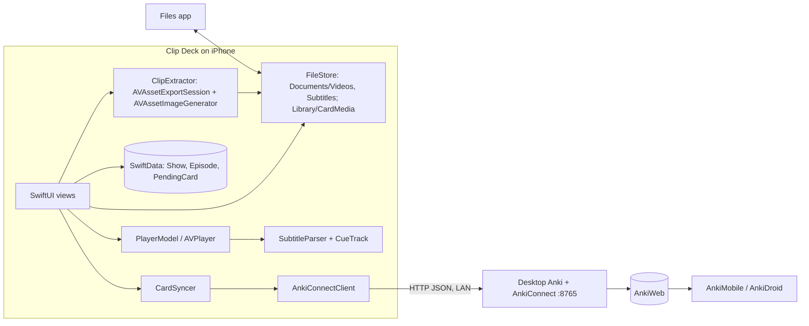

# Clip Deck: architecture

Created with the `iphone-app-setup-skill` skill.

## Overview

Clip Deck is a single native SwiftUI app with no server of its own. Everything works offline. The only network traffic is the user-started Sync, which calls the AnkiConnect add-on on the user's computer.

## Frontend

- **Framework:** SwiftUI, iOS 17.0+, SwiftData, AVFoundation, XcodeGen.
- **Language:** Swift 6 with MainActor default isolation in the app target. AVFoundation is imported with `@preconcurrency` where non-Sendable types cross `await`s.
- **Entry point:** `App/ClipDeckApp.swift`. It sets up:
  - the SwiftData container (in-memory under `-uiTesting`);
  - `SettingsStore` in the environment;
  - the Documents folders;
  - the `.playback` audio session.

  `App/RootView.swift` shows `LibraryView`, after seeding sample media in Debug UI tests.
- **Navigation:** one `NavigationStack` at the library. It pushes `Show` (episode list) and `Episode` (player, or the missing-file screen). Upload, Sync, Anki settings, subtitle picker, offset and card editor are sheets.
- **Features (`Features/`):**
  - Library;
  - Player: `PlayerModel` is `@Observable` and owns the `AVPlayer`, a 20 Hz time observer, the current cue, the offset, and `playSegment`;
  - CardEditor;
  - Sync;
  - Settings.
- **Design system:** `DesignSystem/` (tokens, `DeckTile`, button styles, `ErrorBanner`, `Toast`). `SelectableText` is a `UITextView` wrapper that makes subtitle text selectable so iOS **Look Up** works. Details in DESIGN.md.
- **Persistence:**
  - SwiftData for the library and the card queue;
  - UserDefaults (JSON) for Anki settings;
  - files in the app sandbox.

  Paths are stored **relative to Documents**, because the container path changes on re-install (which happens every 7 days with a free Apple ID).

## Backend

None. The app needs no server: the user owns all the data, and Anki is the destination. AnkiConnect, running inside desktop Anki, plays the role of an API.

## Data and access control

**SwiftData models** (`Models/Models.swift`):
- `Show`: name (unique), colour. Cascade-deletes its episodes.
- `Episode`:
  - title and number;
  - `videoPath` and `subtitlePath` (relative);
  - `offsetMs` and `lastPositionMs`.
- `PendingCard`:
  - id and source;
  - clip range;
  - fields as JSON;
  - media file names;
  - status: `pending` / `synced` / `failed` / `duplicate`;
  - Anki note id and last error.

**Files** (`Services/FileStore.swift`):
- `Documents/Videos/<Show>/<Episode>.<ext>`;
- `Documents/Subtitles/<Show>/<Episode>/<file>`, visible in the Files app;
- `Library/CardMedia/clipdeck_<card-id>.m4a|.jpg`, private.

**Access control:** everything is in the app sandbox. AnkiConnect access can require the optional API key set on both sides.

## Communication

`AnkiConnectClient` (`Services/Anki/`) posts `{action, version: 6, params, key}` JSON to the address the user enters, with an 8 s timeout. It uses these actions:
- `version`, `deckNames`, `modelNames`, `modelFieldNames`;
- `storeMediaFile` (base64);
- `addNote` (`allowDuplicate: false`, `duplicateScope: deck`).

Error handling:
- A transport failure becomes `AnkiError.unreachable`, with setup advice.
- AnkiConnect's `error` string becomes `AnkiError.anki`. Duplicates are detected from that message.

`CardSyncer` sends queued cards oldest-first:
- It uploads media under stable per-card names, so a retry overwrites instead of duplicating.
- It maps fields through the user's field map, HTML-escapes text and turns newlines into ` `.
- It records per-card results.
- It stops at the first "unreachable" error so the remaining cards stay queued.

## Configuration and secrets

| Value | Where it lives | Public? |
|---|---|---|
| AnkiConnect address | In-app Anki settings (UserDefaults) | Yes (a LAN address) |
| AnkiConnect API key (optional) | In-app Anki settings (UserDefaults) | No. A shared password with the user's own Anki, stored on the device; never in the repo |
| Deck, note type, field map, tags, audio padding | In-app Anki settings | Yes |
| Bundle id, display name | `ios/project.yml`, `ios/Config/Shared.xcconfig` | Yes |

The build has no secrets. `.env.example` and `Secrets.example.xcconfig` are unused scaffold placeholders.

## Decisions

| Area | Decision | Why | Alternatives considered |
|---|---|---|---|
| Frontend | Native SwiftUI, iOS 17 | iPhone-only; AVFoundation gives frame-exact seeking and audio export; Look Up is built in | Expo/React Native (needs native modules for clipping anyway; no gain) |
| asbplayer integration | Re-implemented natively (offset, cue list, partial ranges, re-record, field mapping) | asbplayer is a browser extension/web app and can't run inside an iPhone app offline | Embedding asbplayer's web app in a WebView (no tab-audio capture on iOS; no offline file access) |
| Audio capture | Cut audio from the file (`AVAssetExportSession`, M4A) while the segment plays on screen | Exact and independent of device volume or interruptions; same UX as asbplayer's "record" | Recording the output in real time (impossible to capture app audio without ReplayKit) |
| Video formats | MP4/MOV/M4V via AVPlayer | Native, reliable seeking and export | VLCKit for MKV (large dependency; audio export much harder): deferred |
| Anki | Queue on the phone, Sync via AnkiConnect to desktop | User's choice; full fidelity (audio + image + any note type) | .apkg export to AnkiMobile (future option) |
| Dictionary | iOS Look Up + Yomitan-compatible field names | User's choice; zero extra data | Bundled Yomitan dictionaries (future) |
| Project generation | XcodeGen | Text project file, editable from Windows | Committed .xcodeproj |
| Persistence | SwiftData + relative file paths | Simple, local; survives re-install path changes | Core Data, a JSON store |
| ATS | `NSAllowsArbitraryLoads` + `NSAllowsLocalNetworking` | AnkiConnect is HTTP-only and its address is user-entered (LAN IP, `.local`, Tailscale name). The app makes no other requests | Local-networking only (would block VPN hostnames) |
| Builds without a Mac | GitHub Actions macOS runner: simulator tests + unsigned .ipa; Sideloadly installs | Developer has Windows only | Appetize.io (still needs a cloud build; limited minutes) |
| Testing media | Debug-only `TestMediaFactory` generates an MP4 with AVAssetWriter | No binary fixtures in git; works on any runner | ffmpeg-generated fixtures |

## Deployment (not yet done)

- **Personal use (now):**
  - unsigned `.ipa` from CI, installed with Sideloadly;
  - with a free Apple ID: re-install every 7 days, 3-app limit.
- **TestFlight / App Store:**
  - needs an Apple Developer account ($99/yr), a team id (`DEVELOPMENT_TEAM` in `ios/project.yml`), and signing certificates and profiles stored as GitHub secrets;
  - an `xcodebuild -exportArchive` step;
  - a privacy manifest review;
  - before App Store review, reconsider `NSAllowsArbitraryLoads`, which needs a justification.
